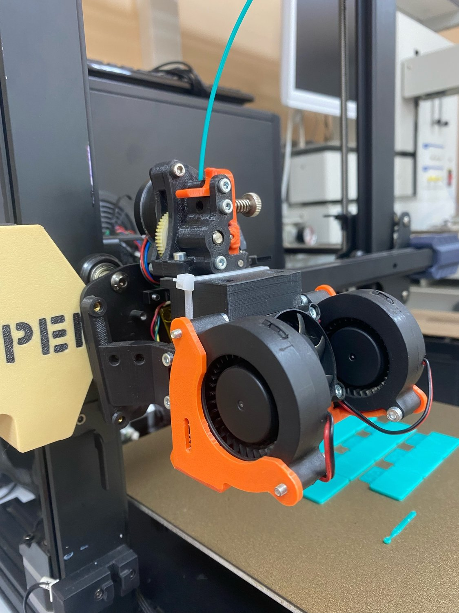
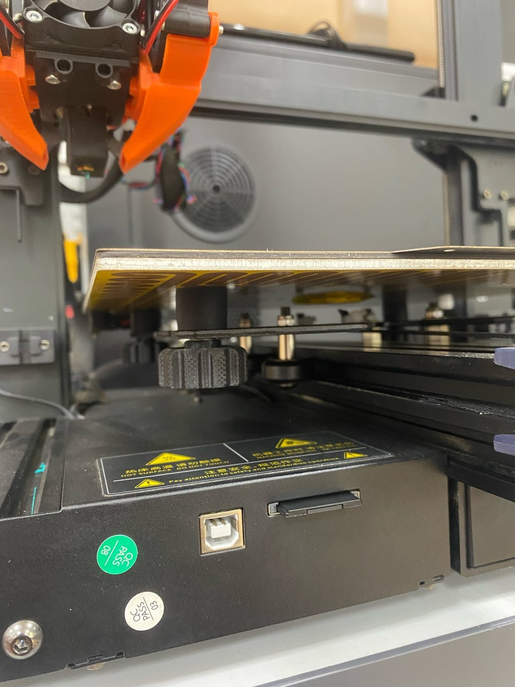
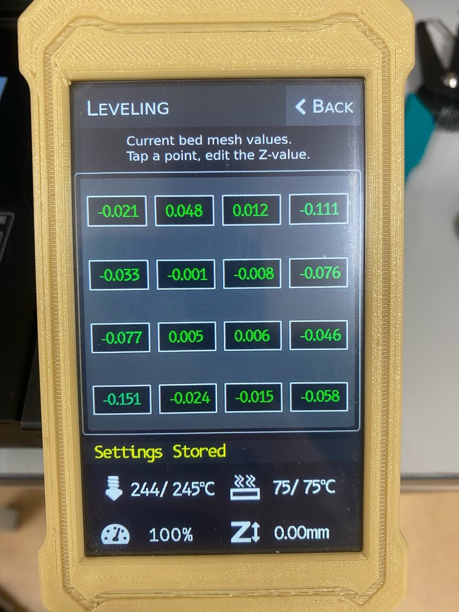

# Community firmware for Anycubic Vyper — CE 6.3.1

[](https://github.com/YumiShiroma/Anycubic_Vyper_MB_CE_6.3/actions/workflows/build.yml)

This repository contains the **mainboard** firmware only. The LCD/touch-screen firmware
stays at **CE 6.2.2** and does not need to be reflashed:

* LCD firmware: <https://github.com/rommulaner/Anycubic_Vyper_LCD_CE_6.2>

CE 6.3.x is a port of the Vyper CE 6.2.2 customizations to **Marlin 2.1.2.9**.
The DGUS touch protocol and the `EXPECTED_UI_VERSION_MAJOR = 622` handshake are
unchanged, so the CE 6.2.2 LCD works with this firmware.

See [CHANGELOG.md](CHANGELOG.md) for the full history.

## What changed in 6.3.1

Maintenance release. The EEPROM layout is unchanged from 6.3.0, so a 6.3.0
configuration is kept.

* The "SD card error" popup no longer stays on screen after the card is
  reinserted, and the stale `Media Init Fail` status is cleared.
* One automatic remount retry when a card fails to initialize on the first try.
* Fixed a potential hard fault when cancelling a host confirmation
  (`strlen(NULL)` in the DGUS status handler).
* CI builds every variant; `scripts/build_all.sh` and a `Dockerfile` make builds
  reproducible. See [docs/TESTING.md](docs/TESTING.md) for the test checklist.

## What changed in 6.3.0

* Rebased on Marlin 2.1.2.9 (latest stable at the time of release).
* Kept the complete Vyper CE 6.2.2 feature set: custom DGUS touch UI, C001/C100
  commands, probe settings, Z homing modes, fan handling, PID/input-shaping
  settings and all build variants.
* Adapted to 2.1.2.9 API changes (`LCD_SERIAL_TX_BUFFER_FREE`,
  `ExtUI::getLevelingIsValid`, renamed PID/stepper options, etc.).
* `EEPROM_VERSION` is now `V89`, so the first boot after flashing **resets the
  EEPROM**. This is intentional: the settings layout changed. Recalibrate after
  the upgrade.
* Default active variant remains `VYPER_BUILD_LA_JD_IS`.

## Machine-specific defaults in this fork

This fork is also the firmware running on the author's own Vyper. That machine is
no longer stock, so the defaults below differ from the generic community firmware.
The firmware-side ones are one-line changes if your machine is different.

### Hardware modifications

The printer has been rebuilt around the stock frame; the strain-gauge probe under
the tool head is retained.

* **Direct drive extruder** instead of the stock bowden setup.
  * Tool head platform and part cooling duct:
    [Hero Me Gen7 Platform Release4](https://www.printables.com/model/39322-hero-me-gen7-platform-release4)
  * Extruder:
    [Sailfin Extruder Remix](https://www.printables.com/model/282299-sailfin-extruderremix)
* **Bed mounting**: the stock rigid corner mounts were replaced with four silicone
  inserts, one under each corner screw. See the probing section below.
* **X and Y motors and toothed pulleys replaced**, and the extruder is now direct
  drive, so `DEFAULT_AXIS_STEPS_PER_UNIT` is not stock either:

```cpp
// this machine
#define DEFAULT_AXIS_STEPS_PER_UNIT   { 100, 100, 400, 689 }
// stock Vyper for comparison
#define DEFAULT_AXIS_STEPS_PER_UNIT   {  80, 100, 400, 405 }
```

| Tool head (direct drive) | Bed mounts (silicone inserts) |
|:---:|:---:|
|  |  |
| Sailfin extruder on the Hero Me Gen7 platform, twin 5015 part-cooling blowers | Silicone inserts under the corner screws, stock rigid mounts removed |


*Bed mesh measured above the inserts. The remaining error on this machine is a mechanical twist of the rear-right / front-left diagonal.*

### Probing above the bed mount inserts

The four bed mount inserts of this machine sit **35 mm** from the left/right edges
and **50 / 51 mm** from the front/back edges of the 250 x 255 bed. The plate is
unsupported (cantilevered) outside that rectangle, and probing near the sheet edge
pressed the overhang down, dragging the corner readings 0.15-0.3 mm below the real
surface. The probe grid is therefore kept above the inserts:

```cpp
#define PROBING_MARGIN_LEFT  35
#define PROBING_MARGIN_RIGHT 35
#define PROBING_MARGIN_FRONT 50
#define PROBING_MARGIN_BACK  51
```

With 4x4 points this gives `X = 35 / 95 / 155 / 215` and `Y = 50 / 101.3 / 152.7 / 204`.
The strip outside the inserts is no longer measured and is extrapolated by the
firmware. On this machine the mesh range dropped from 0.31-0.33 mm to 0.199 mm and
the remaining error is a mechanical twist of the rear-right / front-left diagonal.

If your mounts are in a different place, adjust these four values. For the stock
symmetric behaviour replace them with a single `#define PROBING_MARGIN 15`.

### Filament runout sensor disabled

```cpp
//#define FILAMENT_RUNOUT_SENSOR
```

This machine has no runout sensor fitted, so the feature is compiled out to avoid
false runout stops. Uncomment the line if your printer has the sensor. `M600` and
the normal filament-change menu keep working either way.

## Upgrading from CE 6.2.x

1. Keep a copy of your current calibration values if you want to restore them
   manually later.
2. Flash the new `main_board_*.bin` using the normal Vyper SD-card procedure.
   Keep only one `main_board_*.bin` in the card root; remove the previous one
   before copying a new image.
3. When coming from CE 6.2.x the EEPROM layout changes (`V89`), so the first
   boot after flashing resets it. Run `M502` followed by `M500` (or use the LCD
   reset/initialize action) to store the defaults. Upgrading from 6.3.0 to
   6.3.1 keeps the existing settings.
4. Recalibrate at least:
   * Z offset / first layer,
   * bed mesh,
   * PID for hotend and bed,
   * E-steps (if they differ from the defaults),
   * Linear Advance and Input Shaping if you use those features.

The LCD firmware does **not** need to be flashed, but it must remain on CE 6.2.2
(or a compatible build that uses UI version 622).

## Building

The project is a normal PlatformIO/Marlin project. The active environment is
`STM32F103RET6_ac_tri_f1`.

Single build:

```bash
pio run -e STM32F103RET6_ac_tri_f1
```

All variants (recommended before a release; checks the 491,520-byte flash budget
and copies the images to `dist/`):

```bash
scripts/build_all.sh              # all 14 variants
scripts/build_all.sh LA_JD_IS     # one variant
```

GitHub Actions builds every variant on each push and pull request
(`.github/workflows/build.yml`). A pinned toolchain is available through the
Docker image and the VS Code devcontainer:

```bash
docker build -t vyper-ce .
docker run --rm -v "$PWD":/firmware -w /firmware vyper-ce \
    bash scripts/build_all.sh LA_JD_IS
```

The firmware image is written to:

```text
.pio/build/STM32F103RET6_ac_tri_f1/main_board_<date>-<time>.bin
```

The `random-Vyper-bin.py` script names the binary with a timestamp, as expected by
the Vyper flashing procedure.

PlatformIO downloads the ARM toolchain on the first build. If the download is
blocked or a stale toolchain package is present, remove
`~/.platformio/packages/toolchain-gccarmnoneeabi` and let PlatformIO fetch it
again. If you have built the old Anycubic firmware before, also remove/rename an
old `framework-arduinoststm32@4.10900.200819` package in
`~/.platformio/packages`, as described in the original community firmware README.

## Build variants

Select exactly one variant near the top of `Marlin/Configuration.h` (or let the
helper script do it):

```cpp
//#define VYPER_BUILD_CJ          // classic jerk
//#define VYPER_BUILD_CJ_IS       // classic jerk + input shaping
//#define VYPER_BUILD_LA_JD       // linear advance + junction deviation
//#define VYPER_BUILD_LA_CJ       // linear advance + classic jerk
//#define VYPER_BUILD_LA_JD_T     // + UART to TMC2209 X/Y/Z/Z2
//#define VYPER_BUILD_LA_CJ_T     // + UART to TMC2209 X/Y/Z/Z2
//#define VYPER_BUILD_LA_JD_TE    // + UART to TMC2209 extruder
//#define VYPER_BUILD_LA_CJ_TE    // + UART to TMC2209 extruder
#define VYPER_BUILD_LA_JD_IS      // linear advance + junction deviation + input shaping
//#define VYPER_BUILD_LA_CJ_IS
//#define VYPER_BUILD_LA_JD_IS_T
//#define VYPER_BUILD_LA_CJ_IS_T
//#define VYPER_BUILD_LA_JD_IS_TE
//#define VYPER_BUILD_LA_CJ_IS_TE
```

From the command line:

```bash
python3 scripts/set_variant.py LA_JD_IS
```

`VYPER_NOZZLE_HOMING` is optional:

* Undefined (default): home Z with the two stock Z sensors.
* Defined: home Z with the nozzle probe in the centre of the bed.

For nozzle homing, any adjustable Z flags must be set to maximum extension so the
nozzle reaches the bed after the flags are detected.

## Differences between Z homing modes

The stock mode uses the two Z photo sensors, one per Z motor, and stops each motor
independently. The nozzle-probing mode first lowers until the left Z sensor is
triggered and then uses the nozzle probe as the final Z reference in the centre of
the bed. Nozzle homing gives mesh values closer to zero, but requires a working
probe and correctly adjusted Z flags.

## Troubleshooting

### "Media Init Fail" or "SD card error" on the display

* Use a FAT32 card with an MBR partition table; cards up to 32 GB are the safe
  choice (exFAT and GPT are not supported).
* CE 6.3.1 retries the mount once and clears the message automatically after a
  successful mount. If the message comes back every time, the card, its
  contacts or the slot are the likely cause: try another card, clean the
  contacts and make sure the card clicks into place.
* Only one `main_board_*.bin` should be on the card when flashing.

### "UI version mismatch" or the display does not respond to touch

The mainboard expects LCD firmware CE 6.2.2 (`EXPECTED_UI_VERSION_MAJOR = 622`).
Reflash the LCD from the link at the top of this README; do not mix it with
mainboard firmware from a different UI generation.

### Settings are gone after the upgrade

6.3.0 changed the EEPROM layout to `V89`, so the first boot after flashing it
resets the EEPROM. Run `M502` then `M500`, and recalibrate the Z offset, the bed
mesh and the PID values. Upgrading from 6.3.0 to 6.3.1 does **not** reset the
EEPROM.

### The build fails while downloading the toolchain

PlatformIO needs the ARM toolchain on the first build. On restricted networks use
the container:

```bash
docker build -t vyper-ce .
docker run --rm -v "$PWD":/firmware -w /firmware vyper-ce \
    bash scripts/build_all.sh LA_JD_IS
```

If a stale `toolchain-gccarmnoneeabi` package is present, delete it from
`~/.platformio/packages` and rebuild.

### Rolling back to CE 6.2

Build and flash a 6.2.2 image from the `6.2-legacy` branch. The LCD firmware does
not need to be changed when moving between 6.2 and 6.3.

## Reporting bugs

Open an issue with the [bug report form](https://github.com/YumiShiroma/Anycubic_Vyper_MB_CE_6.3/issues/new?template=bug_report.yml).
Please include your build variant and the output of `M503`. The checklist in
[docs/TESTING.md](docs/TESTING.md) lists what is worth testing after a flash.

## License

Marlin and this community firmware are published under the GPL v3. See
[LICENSE](LICENSE).

This repository distributes **source only**. Prebuilt firmware images are not
published here because the STM32 support libraries used by the build are subject
to ST's license terms. Build the firmware yourself with the instructions above.

The Vyper mainboard uses a GD32 (non-ST) MCU; building and using this firmware is
your own responsibility with respect to those terms.
